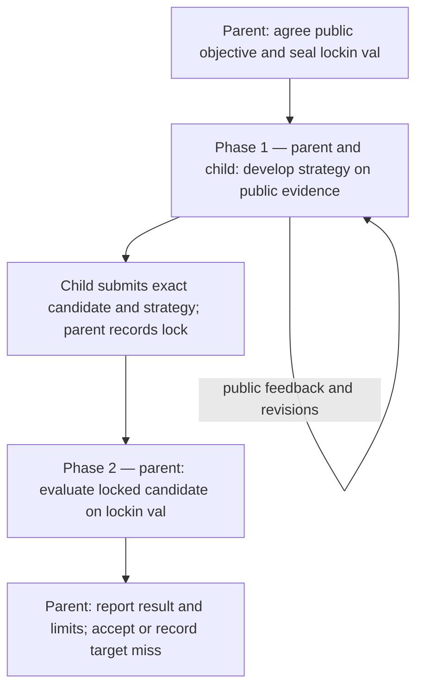

# multica-hidden-test

Draft a standalone Multica SOP for research that survives a hidden evaluation. A parent helps a child develop a general strategy on public evidence, then evaluates one frozen candidate on a parent-held `lockin val` set.

**Status: design draft.** This repository describes the proposed product and its first implementation scope. It contains no installer, executable SOP or live evaluation results.

## Two phases

`lockin val` means the evaluation cases, answers and case-specific details reserved by the parent before development. The child knows the task, allowed inputs, evaluation method and success criterion. The child does not see the reserved cases or receive scores from them while choosing a strategy.

The parent coaches from public development results: ask for a mechanism, suggest public counterexamples, and help the child test whether its approach transfers. The parent must not turn knowledge of hidden cases into hints. At the phase boundary, freeze the strategy, source revision, dependencies and any submitted artifact. The parent then evaluates that exact candidate once. A miss is a research result; editing against that result would consume the holdout for future use.

This design interprets the two phases as **collaborative development, then locked hidden evaluation**. A finite hidden set provides evidence about generalization within its declared scope; it cannot prove universal generalization.

## Modeled on multica-featssship

Follow [multica-featssship's standalone packaging and handoff pattern](https://github.com/Winfred666/multica-featssship/tree/e4d8ff30cf8dc10e009034625ef0d198feb94503): one repository, README-led installation, repository-owned procedures, distinct native agent identities and comments for handoffs. Keep generated packages and runtime state untracked. Do not depend on system distribution, review or delivery SOP packages.

The research parent has a larger role than featssship's dispatch-only MAIN: it owns the hidden evaluation boundary, coaches development and makes the final research decision. The child owns strategy and implementation. Historical parent/child delivery and review procedures are design references; their executable packages are not runtime dependencies.

## Proposed installation

A future one-time installer runs in the target repository and reuses saved answers. It selects the workspace, target project, existing parent issue, repository, distinct Parent and Researcher agents, public task and inputs, allowed resources, development command, unchanged evaluation command, success criterion and time budget. The parent configures the private evaluation location through a parent-only channel; that location and its contents must never enter child packages or shared configuration.

Preserve the existing parent issue, its history and unrelated bindings. Publish only the public research contract in the target project and child description. MAIN may be the parent; no extra coordinator or evaluator agent is required. Each invocation uses its own native task identity and reconstructs progress from the permitted native records.

Installation must verify that the child cannot read the hidden inputs, parent-private records or evaluator credentials, including through the Multica CLI. A separate agent name, Git branch or folder does not enforce this. Use existing access controls or an owner-operated evaluator. If those are unavailable, report that the privacy prerequisite is unmet before starting a trial.

## First implementation scope

Build one complete path: configure the two roles, seal the holdout, dispatch one research child, iterate on public evidence, lock one candidate, evaluate it, and return one concise result to the parent thread. Use the existing task's evaluator and artifact contract. Add no benchmark platform or new scoring rubric.

The intended package has a root Parent SOP, a fixed Researcher skill and a parent-only evaluation procedure. Follow featssship's portable local-skill layout and the current Symbolic-SoP template when implementation begins. Installation remains an ordinary script. Keep procedures and their required runtime files in this repository without submodules.

Keep focused checks under `tests/`. One disposable trial should demonstrate a public correction, an exact candidate lock, denied child access to hidden material, evaluation of the locked revision and one result receipt. Exercise a hidden miss without reopening the same holdout for tuning. Simulated role choices establish script behavior; a later isolated native trial must establish routing and the actual access boundary.

Implementation and isolated trials belong in this project's future development work. Existing Research, RSI, shared services and installed SOPs stay outside that work's scope.

Read the [workflow contract](docs/workflow.md) for ownership, visibility, transitions, results and failure handling.
