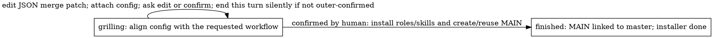

# Shipping flow

Installation has two states:

Defaults and field comments guide each edit toward the requested workflow. Keep
settings that already fit, and edit again as needed. Ask one human question only
when context leaves something unclear. Editing does not create
roles, skills or MAIN. Confirmation must be a human reply after the latest config
comment. The human only replies `confirm`; the agent runs `confirmed` and the
script finds that reply automatically. The JSON role key is `delegator`. The installer owns one logical master JSON
attachment containing installation settings and defaults. MAIN receives only
its explicit owner/filename reference in `featssship.config`, not copied defaults
or an installer-parent link. It subscribes CEO and runs independently after the
installer finishes. Re-entry preserves settings and starts another MAIN;
unfinished cycles retain their immediate MAIN checkpoint for retries.

Attachment revisions temporarily replace unavailable native mutable deliverables.
`common.py` isolates upload and authenticated download/read, with TODOs for native
update/preview. Grilling publishes a confirmation prompt with each attachment revision in the
existing thread; other revisions use an empty-rendering comment. Readers select the latest matching owner/filename. References
remain valid after edits, across issues. Serialize edits; immutable attachments
provide no compare-and-swap. Old revisions remain history. Defaults are created
only when the master document is absent. Nothing caches JSON locally or in SoP
state. Cached guidance contains routing text only, not rendered configuration.
See [README](../README.md#configuration) for editing. Runtime resolution has no
metadata fallback or ancestry lookup. Stale owned MAIN configuration can be
deleted on upgrade; retain live execution checkpoints and unrelated data.

The project description still owns verification guidance and repository/scope
context, never selected review questions or installed identities.
The installer action graphs live in [its controller](../installation/controller.py).

MAIN runs one sequential batch with `--thread <request UUID>` and optional
`--config '{"issues":[{}]}'` (one default item). Grilling shows a fresh JSON working
copy; `refresh --config-file PATH` replaces the whole batch and invalidates approval.
Dispatch requires the original member's confirmation or acceptance after that
draft before creating children or branches. Partial failures retain checkpoints
and retry in grilling without restarting successful children. Once a child exists,
resume dispatch rather than refreshing.

Children share the delegation attachment by item index; universal settings resolve
from the installer master and verification commands from the project description.

MAIN passes a short name;
the configured direction prefix formats the feature branch. The child uses its
prepared issue worktree for one shared [procedure](../delegation/dev-rev/controller.py):

```dot
digraph develop_review {
  rankdir=LR; node [shape=box];
  develop [label="Developer: implement, test and submit"];
  review [label="Reviewer: inspect exact revision"];
  approval [shape=diamond, label="manual config?"];
  approve [label="Reviewer: auto-approved action"];
  manual_approve [label="manual_approve: wait for outer instruction"];
  merge_result [shape=diamond, label="Merge conflict / rework?"];
  finished [label="finished: cleaned, pushed if approved, reported", peripheries=2];
  develop -> review [label="submit"];
  review -> develop [label="rework"];
  review -> approval [label="approve"];
  approval -> approve [label="automatic"];
  approval -> manual_approve [label="manual"];
  approve -> merge_result [label="final_approve: merge_approved"];
  manual_approve -> merge_result [label="final_approve: same merge_approved; ONLY outer allowed"];
  manual_approve -> develop [label="rework: Reviewer returns corrections"];
  develop -> finished [label="cancel: cleanup only"];
  review -> finished [label="cancel: cleanup only"];
  manual_approve -> finished [label="cancel: cleanup only; ONLY outer allowed"];
  merge_result -> develop [label="rework"];
  merge_result -> finished [label="merged: cleanup then push automatically"];
}
```

Both roles use the current issue folder and the same metadata record. The native
agent ID guards each phase. MAIN's `name: tree-horizontal-more` plus installed
`branch_prefix: feat/frontend` binds `feat/frontend/tree-horizontal-more` before dispatch.
Developer owns only develop; Reviewer owns all subsequent states. Neither role names or creates the branch.
Later actions reject another branch or repository; review and integration also reject a changed HEAD.
Dispatch prepares the metadata-selected local branch and one issue-owned worktree.
`manual` is a boolean inherited from installation and overridable per batch item.
Only manual mode creates/pushes a remote feature branch; its first push leases
the reserved revision and corrections lease the prior submission. Automatic
features stay local until their approved result is pushed to the existing parent branch.
Features share no branch registry or SOP-wide lock.
A manual config adds the manual label before the child starts. Review never
creates a checkout or switches branches. Automated review approval hands the
Reviewer the `final_approve` action; manual approval waits in `manual_approve` for
human or MAIN input. Both states use `final_approve` to call the same `merge_approved`
function. It checks the exact approved HEAD, merges/tests, and fast-forwards local
main in its clean existing worktree (or atomically advances its unoccupied ref).
No feature worktree changes branch. The merge-result diamond comes before terminal
finished: conflicts return to develop with the unresolved merge preserved, for a
resolution merge commit and another review. Success continues directly through
local feature cleanup, parent push and MAIN delivery, then enters finished.
A rejected push restores the local feature branch/worktree for rework. There is
no reported state, final-state action or finish command.

Cancellation is available in develop and review for scope, Git/version
infrastructure or edit-budget blockers, and in manual_approve for outer
cancellation. Preserve or commit edits first. The script deletes the local
feature tree/branch, marks the issue cancelled and enters finished without tests,
integration or pushes. Reviewer may invoke this fixed cleanup but remains
read-only for source; approved integration runs the scripted checks. Human acceptance owns done.

State owners resolve native `{id, name}` in the wrapper for actor checks,
handoffs and tiny HTML labels.

Each successful delivery
posts one concise recipient mention using the declared state's native owner name, without
TODO, self-reference or SHA. Reports to MAIN are receipt-only notes under the
original dispatch comment, using native `/note` without mentions or steering. The batch attachment retains the original dispatch thread.
The acting agent interprets superior instructions; scripts verify identity and
ordering, not literal approval wording. Blocked recipient delivery fails the
handoff. Steering requires a matching running
recipient with `can_supplement: true`; otherwise the mention takes the normal route.
The sender ends this turn silently after handoff: "Rework sent, directly and silently end this turn"
for rework, the superior wait for manual approval, and otherwise
"Delivery done this round, directly and silently end this turn". Metadata and HTML
retain the receiving role's guidance. Failures remain errors. This is guidance,
not enforced turn completion or a measured token saving; enforcement belongs to
the runner ([multica-RSI#40](https://github.com/Winfred666/multica-RSI/issues/40)).
Wrong-role action calls exit nonzero on stderr without JSON or writes.

Select `review` to inspect the issue's criteria and selected process questions.
The selected direction supplies universal review questions; the delegation adds
only its request-specific acceptance/question overrides. Reviewer returns one `--finding` with `approve` or `rework`.
Question order is presentation order, not per-question stepping or parallel tasks.

The HTML graph comes from `Workflow`; action docstrings explain local logic.
`DEBUG` defaults to `true` in the source bundles and newly built packages' `config.json`.
During native runs, each state change or completion publishes an HTML graph
highlighting the actual resulting state. Selecting a node only inspects its
guidance; it does not advance the workflow. Package rebuilds retain existing
settings, so enable `DEBUG` explicitly in older packages. No renderer service
is required. Callbacks use the running wrapper’s resolved file path; temporary
preview builds show temporary paths, not installed skill locations.

`installation/` owns the reusable common module and runtime. The builder includes
them in each standalone installation, delegation and dev-rev package; source
controllers remain in their respective procedure folders.

Implementation note: delegation declares only `grilling`; runtime-owned `FINISHED`
is the ringed-circle target that deletes only its SOP key and emits callback-free
exit guidance. See the [runtime TODO](../installation/wrapper.py) for completion modes.
